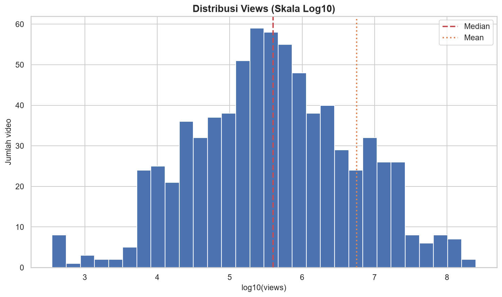
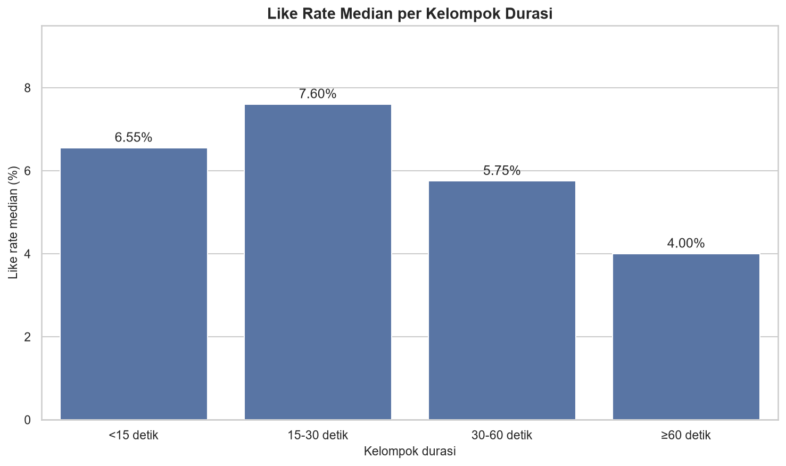
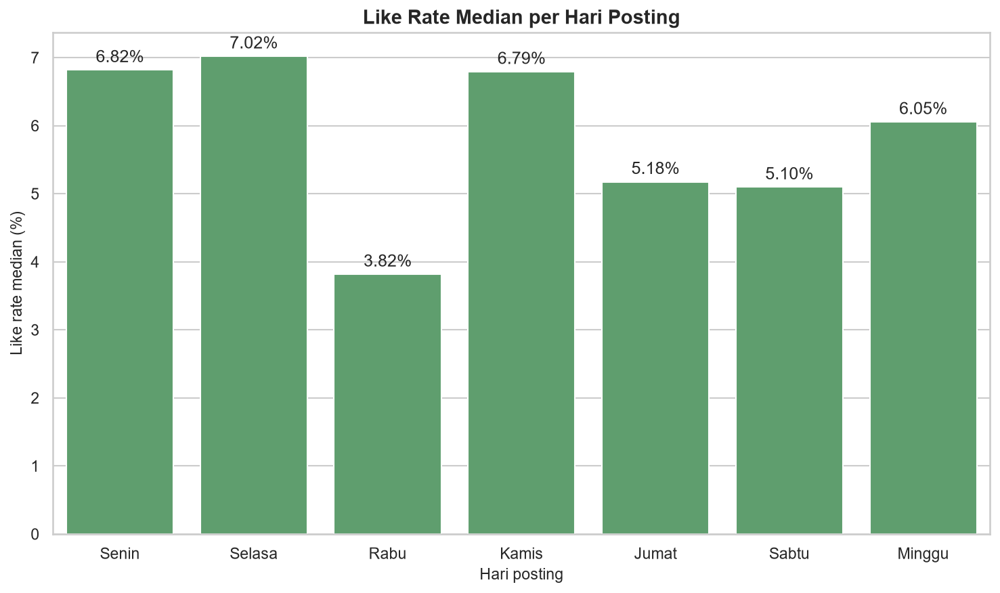
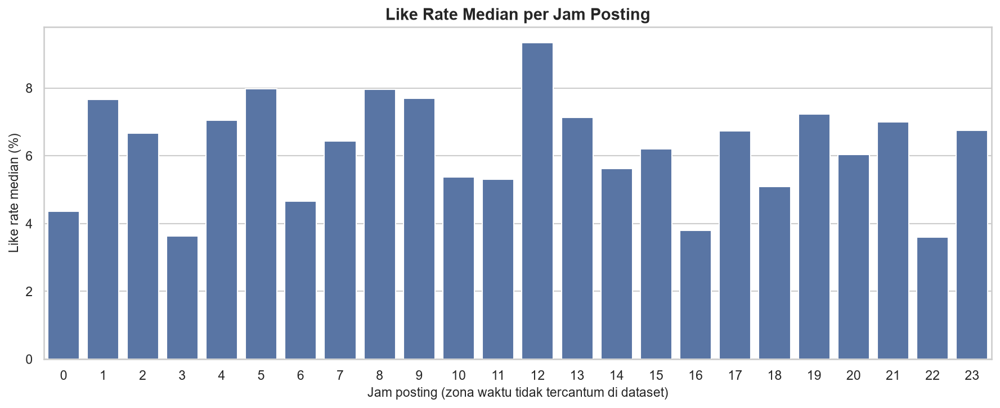
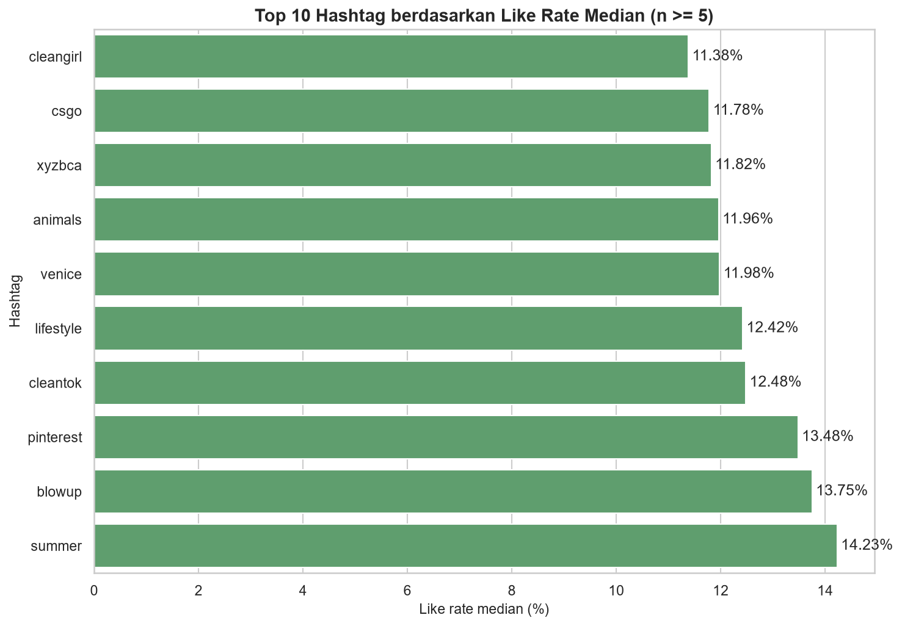
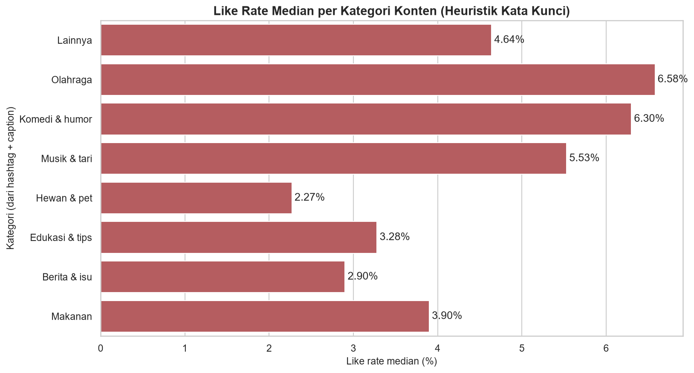
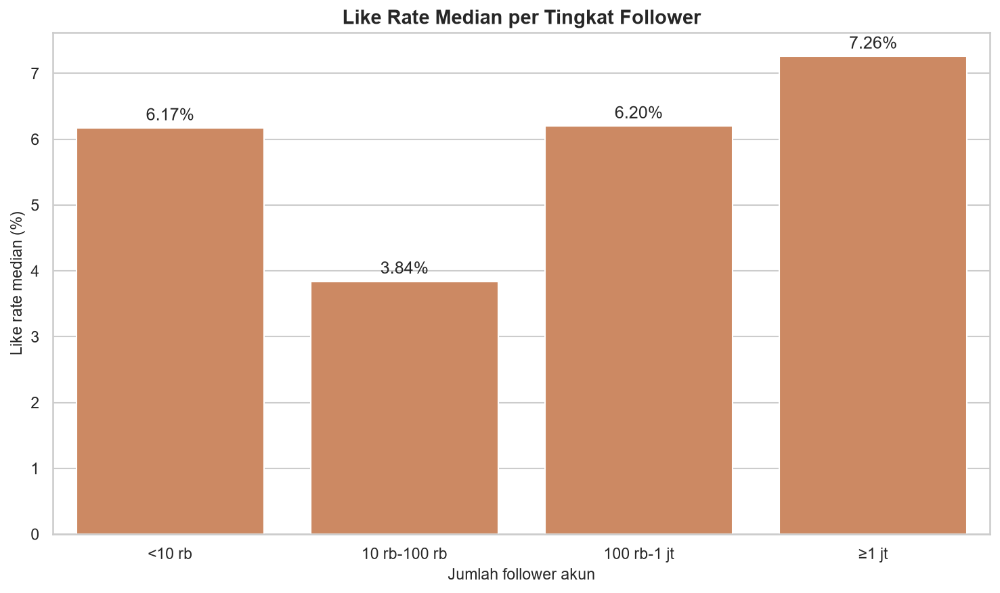
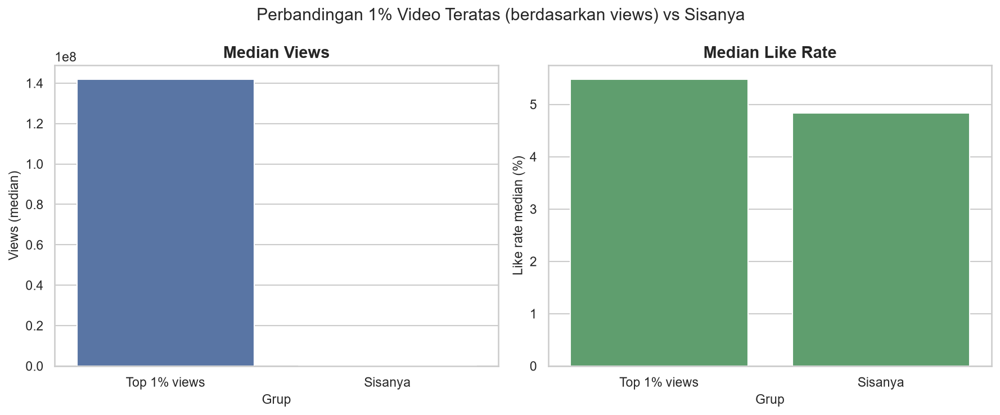
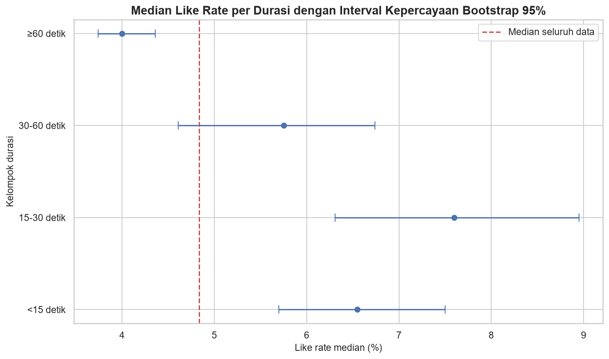
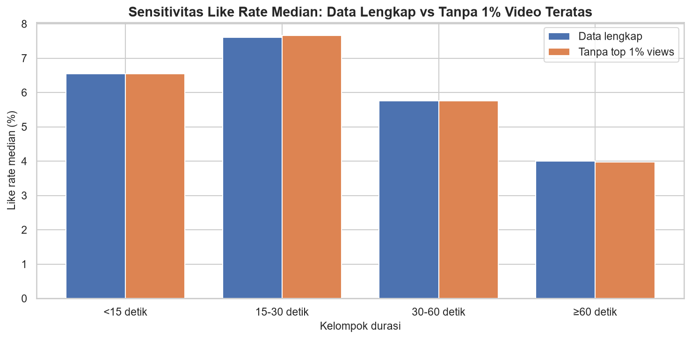

# Analisis Konten TikTok

## Tujuan

Menjawab satu pertanyaan utama: **jenis konten apa yang paling banyak mendapat interaksi di TikTok?** Analisis memakai dataset metadata TikTok dari Kaggle yang diunggah manual, tanpa scraping. Fokusnya adalah pola pada data yang tersedia, bukan klaim tentang usia penonton, wilayah tertentu, atau sebab-akibat.

## Maksud

Project ini dibuat sebagai portofolio Data Analyst: menunjukkan alur kerja lengkap dari data mentah sampai laporan, sekaligus cara bersikap jujur ketika data tidak mendukung sebuah pertanyaan.

- Data awal 760 baris, setelah pembersihan menjadi **751 baris × 16 kolom** (rentang waktu 2015–2025).
- Kolom yang tersedia hanya `views` dan `likes` untuk interaksi, jadi metrik yang dipakai adalah **proxy `like_rate = likes / views`**, bukan engagement rate definisi penuh.
- Video viral sengaja **tidak dibuang**; analisis memakai median, persentil, log skala, bootstrap, dan uji berbasis peringkat.
- Pertanyaan yang tidak bisa dijawab dinyatakan terus terang, bukan dipaksakan.

## Insight

1. **Like rate median seluruh data 4,84%** (interval kepercayaan bootstrap 95%: 4,58%–5,35%). Median views 394.800, sementara mean 5.661.243 — beberapa video sangat viral menarik mean naik, sehingga median yang dipakai.
2. **Durasi 15–30 detik punya like rate median 7,60%** (n=133), lebih tinggi daripada durasi ≥60 detik **4,00%** (n=345). Uji Kruskal-Wallis dan perbandingan setelah koreksi Bonferroni signifikan, tetapi pola ini hanya konsisten pada **2 dari 5 tahun** yang cukup sampel. Artinya: asosiasi pada sampel ini, **bukan bukti bahwa durasi menyebabkan like**.
3. **8 video teratas (1%) menyumbang 29,0% total views dan 26,4% total likes.** Like rate median mereka 5,48%, sedikit lebih tinggi daripada sisanya 4,84%.
4. **Hashtag paling sering adalah `fyp`** (228 video, like rate 6,76%), tetapi like rate tertinggi ada pada `summer` (14,23%, n=11). Item yang tetap muncul ketika ambang diubah adalah `csgo`, `trend`, dan dua ID audio anonim — semuanya **asosiasi, bukan sebab-akibat**. Kata kunci caption tidak ada yang mencapai ambang minimal 5 video, jadi tidak dibuat klaim.
5. **Akun dengan ≥1 juta follower punya like rate 7,26%** (n=99), namun korelasi followers dengan like_rate hanya 0,100. Akun besar lebih banyak ditonton (korelasi dengan views 0,340), tetapi like per tayangan tidak ikut naik kuat.
6. **Jam 22:00 menyumbang 173 video dengan like rate 3,59%.** Karena zona waktu tidak ada dan sampel terpusat pada jam itu, ini kemungkinan artefak pengumpulan data — **bukan rekomendasi jam posting**.
7. **Dua pertanyaan tidak bisa dijawab:** perbedaan bahasa/wilayah (termasuk fokus Indonesia) dan jenis interaksi dominan per konten, karena kolom bahasa, negara, komentar, dan share tidak tersedia. Kategori konten buatan sendiri hanya menjangkau 31,7% video, jadi tidak dipakai sebagai kesimpulan utama.

## Grafik

**Distribusi views (skala log10).** Mean tertarik ke kanan oleh sedikit video viral, sehingga median lebih mewakili video umum.

**Like rate median per kelompok durasi.** Durasi 15–30 detik memiliki like rate median tertinggi sekaligus median views tertinggi di antara kelompok berdurasi jelas.

**Like rate median per hari posting.** Rabu punya like rate median terendah dengan sampel terbanyak, sedangkan Selasa tertinggi dengan sampel lebih sedikit.

**Like rate median per jam posting.** Jam 22 menyumbang sampel paling banyak dengan like rate rendah, kemungkinan artefak pengumpulan data.

**Top 10 hashtag berdasarkan like rate median.** Hashtag dengan like rate tinggi belum tentu paling sering dipakai.

**Like rate median per kategori konten.** Kategori ini tesaurus buatan sendiri dan cakupannya terbatas, bukan label resmi TikTok.

**Like rate median per tingkat follower.** Korelasi followers dengan like_rate lemah meski tier teratas punya median tertinggi.

**Perbandingan 1% video teratas vs sisanya.** Delapan video teratas menyumbang porsi besar total views dengan like rate median sedikit lebih tinggi.

**Median like rate per durasi dengan interval kepercayaan bootstrap 95%.** Interval 15–30 detik seluruhnya di atas interval ≥60 detik, jadi perbedaan sulit dijelaskan kebetulan sampel.

**Sensitivitas like rate median: data lengkap vs tanpa 1% video teratas.** Membuang delapan video viral mengubah median maksimal 0,06 poin persen.

---

Sumber data: *TikTok Video Metadata* (Kaggle), lisensi Apache 2.0, diambil dengan upload manual. Cara pengumpulan tidak dijelaskan rinci di halaman Kaggle. Kode dan tabel hasil ada di `notebooks/` dan `outputs/`; laporan lengkap ada di `laporan/06_laporan_analisis.md`.
